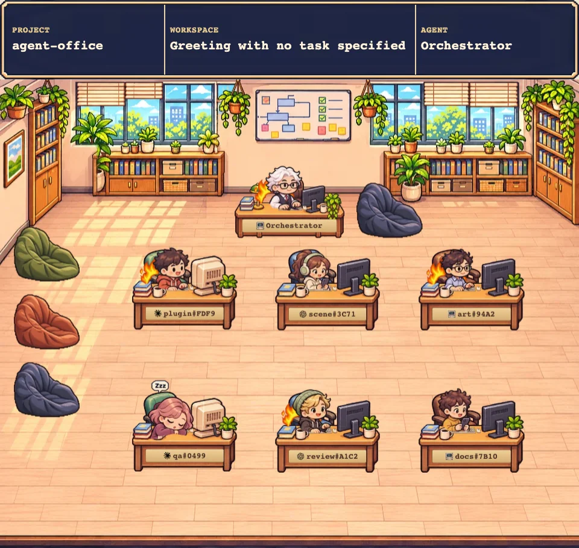
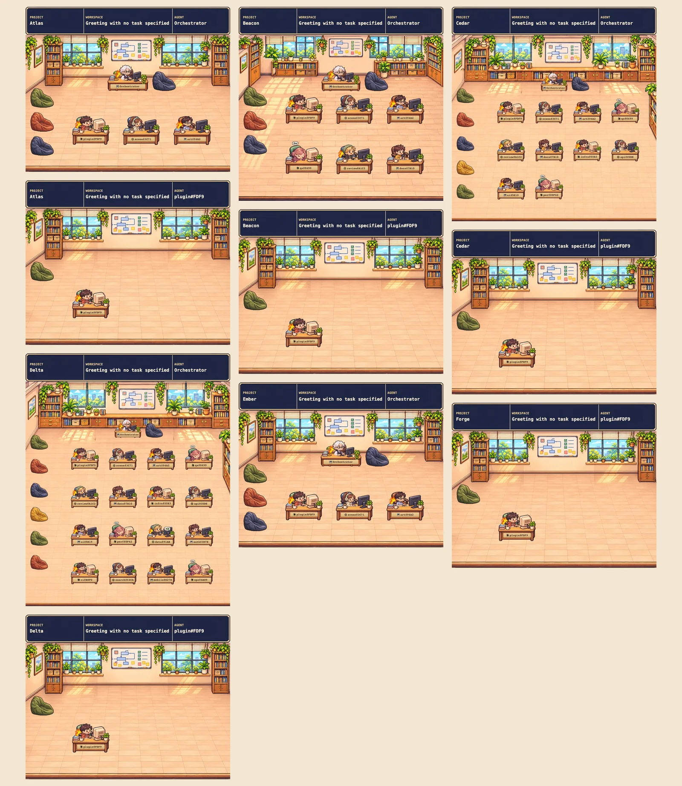
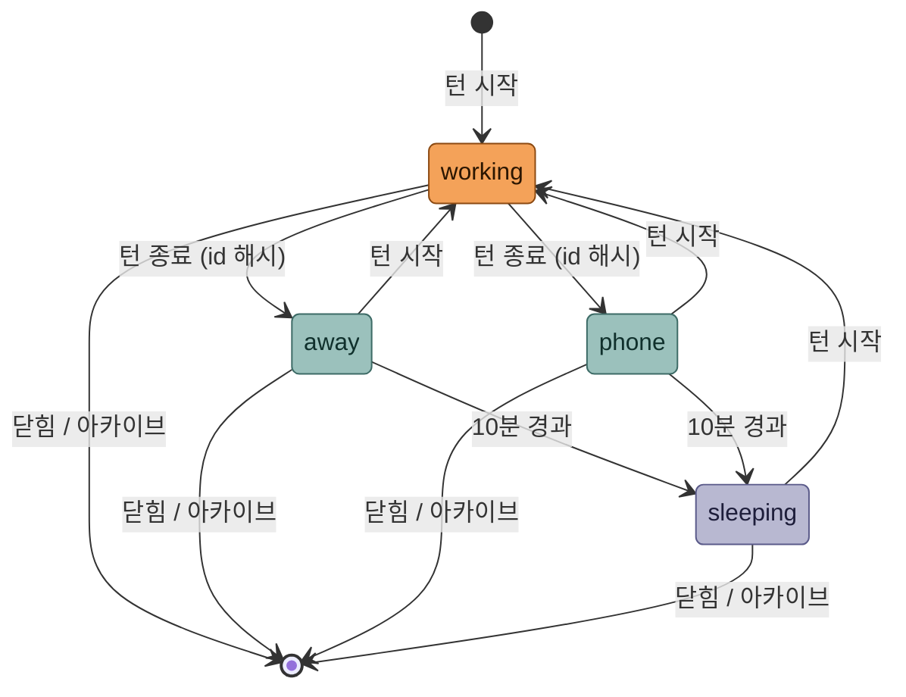
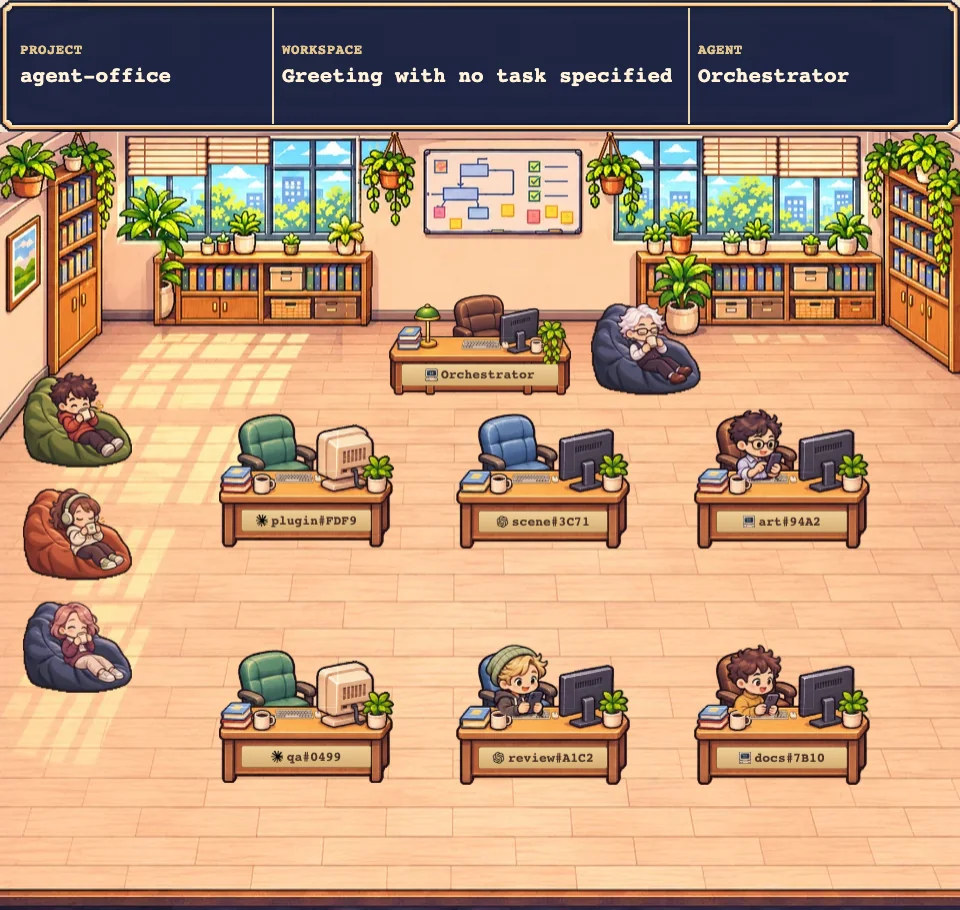
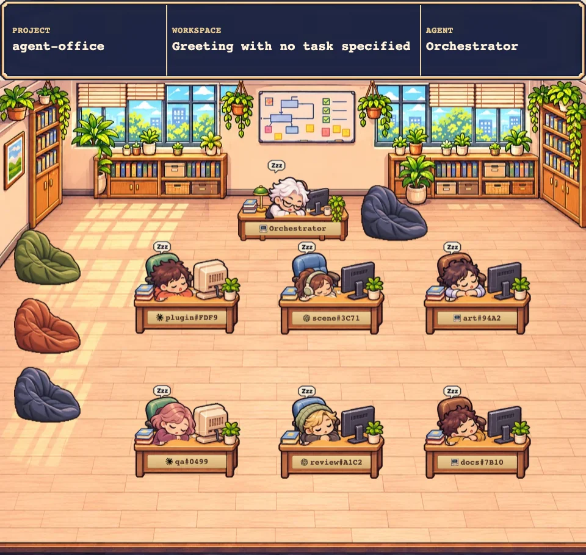

# Agent Office

Paseo의 에이전트들을 작은 사무실의 직원처럼 보여 주는 Paseo 플러그인입니다. 턴을 실행 중인 에이전트는 자기 책상에서 타이핑하고, 일이 끝나면 휴대폰을 보거나 빈백에서 쉬고, 오래 쉬면 책상에 엎드려 잡니다. 권한 승인을 기다리는 에이전트는 머리 위에 노란 `!`가 떠서 바로 눈에 띕니다.



## 어디에서 보나

플러그인은 두 곳에 화면을 추가합니다.

- **워크스페이스 패널 "Agent Office"**: 그 워크스페이스가 속한 프로젝트의 오피스를 보여 줍니다. 상단바에 PROJECT / WORKSPACE / AGENT가 표시됩니다.
- **왼쪽 사이드바 "Agent Office"**: 에이전트가 있는 모든 프로젝트의 오피스를 핀터레스트처럼 높이가 다른 카드로 엇갈리게 쌓아 보여 줍니다. 같은 프로젝트의 오피스는 한 열에 이어 붙습니다.



명판이나 캐릭터를 클릭하면 해당 에이전트로 이동합니다.

## 오피스 구성

오피스는 프로젝트 단위로 묶입니다. 다른 에이전트가 시작한 에이전트(예: orchestrator가 띄운 팀)는 같은 프로젝트라면 워크스페이스가 달라도 한 오피스에 모이고, 시작한 에이전트가 관리자가 됩니다. 팀이 없는 에이전트는 혼자 쓰는 오피스를 받습니다. 닫히거나(closed) 아카이브된 에이전트는 오피스에서 빠집니다.

- **관리자(orchestrator)**: 방 뒤쪽 벽 앞 중앙의 큰 책상에 앉아 팀원들을 마주 봅니다. 쉴 때는 자기 책상 옆 전용 빈백을 씁니다.
- **팀원**: 아래쪽 책상 격자에 앉습니다. 인원 수(1~16명)에 따라 책상 배치와 방 크기가 정해진 규칙으로 바뀝니다.
- **휴식 구역**: 방 왼쪽에 빈백이 세로로 놓여 있습니다(작은 방과 중간 방 3석, 큰 방 6석). 자리가 모자라면 자기 책상에서 쉽니다.
- **명판**: 책상 앞판에 provider 아이콘(claude, codex, antigravity, copilot, muse, opencode)과 에이전트 이름이 붙습니다.

## 에이전트 상태

플러그인은 daemon의 에이전트 lifecycle 이벤트를 받아 에이전트마다 상태를 하나씩 정합니다. 턴이 시작되면 `working`이 되고, 턴이 끝나면 `away`(빈백에서 휴식)나 `phone`(자리에서 휴대폰) 중 하나가 됩니다. 둘 중 무엇이 될지는 에이전트 id의 해시로 정해지므로 같은 에이전트는 늘 같은 방식으로 쉽니다. 쉬는 상태가 10분 넘게 이어지면 `sleeping`이 되고, 다시 턴이 시작되면 어느 상태에서든 `working`으로 돌아갑니다. 권한 승인을 기다리는 동안에는 상태는 `working`으로 두고 `needsAttention` 표시만 붙입니다.



상태마다 화면에서는 이렇게 보입니다.

| working | away |
| --- | --- |
|  |  |
| 책상에서 타이핑합니다. 60초 넘게 일하면 어깨 뒤로 불꽃이 붙고, 가끔 `+3`, `Done!`, `PR up!` 말풍선이 뜹니다. | 자리에서 일어나 왼쪽 빈백까지 걸어가 앉아 쉽니다. |
| **sleeping** | **승인 대기 (needsAttention)** |
|  |  |
| 책상에 엎드려 자고 `Zzz`가 뜹니다. | 머리 위에 노란 `!`가 뜹니다. 이때는 다른 말풍선을 띄우지 않습니다. |

상태가 바뀌면 캐릭터는 책상 사이 통로를 따라 정상 보행 속도로 걸어갑니다. 여러 명이 동시에 움직일 때는 0.3초 간격으로 출발해 서로 겹치지 않고, 걷는 도중 상태가 다시 바뀌면 그 자리에서 새 경로로 돌아섭니다.

## 설치

Paseo 0.15.2 이상이 필요합니다(`paseo daemon status`의 `daemonVersion`으로 확인).

```sh
# 처음 설치: 저장소 경로를 넘깁니다
paseo plugin install /path/to/agent-office

# 코드를 바꾼 뒤 다시 불러오기: 경로가 아니라 플러그인 id를 넘깁니다
paseo plugin reload agent-office
```

다시 불러온 뒤에도 화면이 예전 그대로면 Agent Office 탭을 닫았다가 다시 여세요. 클라이언트 코드는 화면이 새로 마운트될 때 바뀝니다.

## 동작 방식

데이터는 아래 순서로 흐릅니다. 모든 처리는 로컬 daemon 안에서 일어나고, 외부로 보내거나 디스크에 쓰는 것은 없습니다.

```
daemon 이벤트·에이전트 목록 → server 상태 저장소(메모리) → office.snapshot RPC(약 2초 주기) → client scene 렌더링
```

daemon이 재시작되면 저장소도 비워지고, daemon이 이미 알고 있는 에이전트 목록에서 다시 채워집니다.

리소스를 아끼기 위해 화면은 다음 규칙을 따릅니다.

- 오피스 한 칸의 최대 폭은 480 CSS px입니다. 사이드바 화면의 카드 폭은 410~480px입니다.
- 화면은 초당 약 12번만 다시 그리고, 모든 카드가 타이머 하나를 함께 씁니다.
- 탭이 숨겨지거나 카드가 화면 밖에 있으면 그리기를 멈춥니다. 화면에서 멀어진 카드는 캔버스 메모리를 해제합니다.
- 스프라이트는 화면에 필요한 해상도(480px × DPR 2)에 맞춘 WebP로 플러그인 번들에 들어갑니다.

## 개발

```sh
npm ci                 # 의존성 설치
npm run typecheck      # TypeScript 검사
npm run check:state    # 상태 기계 자체 점검
npm test               # unit test (tests/unit)
npm run sprites        # assets/office/manifest.json → client/scene/generated/office.ts 재생성
npm run preview        # 브라우저 미리보기 빌드
```

미리보기는 실제 플러그인과 같은 렌더러를 씁니다. 저장소 루트를 정적 서버로 띄운 뒤 `client/scene/preview.html`을 엽니다(예: `python3 -m http.server`). 상단 메뉴에서 인원 수와 상태를 바꿀 수 있고, `window.preview.setTime`, `setTransition`, `setTransitionSequence`로 시간을 고정해 특정 프레임을 볼 수 있습니다. 자세한 사용법은 [client/scene/README.md](client/scene/README.md)에 있습니다.

시각 회귀 테스트는 `tests/` 안에서 따로 실행합니다.

```sh
cd tests
npm run test:visual          # Playwright 시각 비교
npm run test:visual:update   # 의도한 변경이 있을 때 기준 이미지 갱신
```

## 폴더 구조

| 경로 | 내용 |
| --- | --- |
| `index.server.ts`, `server/` | daemon 훅 구독, 상태 저장소, 스냅샷 RPC |
| `shared/state/` | 상태 계약(`contract.ts`), 상태 기계, RPC 정의 |
| `index.client.tsx`, `client/` | 패널과 사이드바 화면, 오피스 캔버스 렌더러(`client/scene/`) |
| `assets/office/` | 런타임 스프라이트와 `manifest.json`(좌표, 프레임, 그리기 순서 규격) |
| `assets/mockups/` | 디자인 시안 기록(v7~v10) |
| `tests/` | unit test와 Playwright 시각 회귀 테스트 |
| `docs/visual-qa/` | 화면의 어색한 장면을 찾아 고친 기록(VQA 리포트) |
| `docs/screenshots/` | 이 README의 스크린샷 |

## 알려진 제한

- daemon이 시작되기 전부터 있던 에이전트는 daemon이 팀 에이전트에 붙이는 `paseo.parent-agent-id` 라벨로 묶습니다. 이 라벨은 문서화되지 않은 내부 규칙이라 Paseo 버전에 따라 바뀔 수 있습니다. 그 뒤에 만들어진 에이전트는 공식 parent 필드로 묶습니다.
- 빈 빈백도 항상 보입니다(VQA-005, 보류).
- 이미지는 화면 해상도에 맞춰 줄여 넣었기 때문에, 인원 수에 따라 캐릭터가 약간 확대되어 그려질 때는 조금 흐려질 수 있습니다.

## 스크린샷 다시 찍기

`docs/screenshots/`의 이미지는 미리보기(`client/scene/preview.html`)를 Playwright와 시스템 Chrome으로 열고, `setTime`과 `setTransition`으로 시간을 고정해 찍은 뒤 WebP(품질 85)로 변환한 것입니다. 워크스페이스 패널 장면은 6명, 폭 480px, DPR 2이고, 전체 오피스 장면은 폭 1600px입니다.
